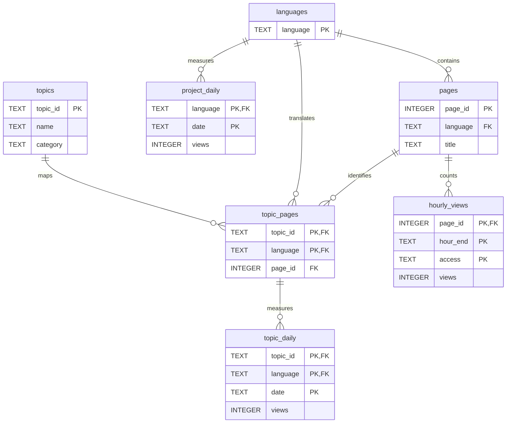

# SQLite ER diagram

`pages` has a unique `(language,title)` key. `topic_daily` references the composite `(topic_id,language)` key in `topic_pages`. The three fact tables have different grains and are never concatenated. Access and timestamps describe public aggregated counts, not identifiable people.
